# Loja Aurora — Triagem de mensagens com IA

Solução para o **Desafio Técnico KODIE — IA e Automação**, caso **4.1 Classificação de mensagens**.

Uma mensagem de cliente entra por um webhook do **n8n**, é classificada pela **API Express** com o **Google Gemini**, e o resultado vai para uma planilha do **Google Sheets**, já em português e separado por urgência.

```bash
curl -X POST http://localhost:5678/webhook/classify \
  -H 'Content-Type: application/json' \
  -d '{"message":"Comprei um tênis há 10 dias e ainda não chegou. Já é a segunda vez!","customer":"Maria Souza","channel":"whatsapp"}'
# → complaint · logistics · high · negative  (e uma linha nova nas abas classificacoes e urgentes)
```

## Sumário

1. [Apresentação da ideia](#1-apresentação-da-ideia)
2. [Problema escolhido](#2-problema-escolhido)
3. [Solução proposta](#3-solução-proposta)
4. [Tecnologias utilizadas](#4-tecnologias-utilizadas)
5. [Funcionamento do sistema](#5-funcionamento-do-sistema)
6. [Como executar](#6-como-executar)
7. [Documentação do fluxo n8n](#7-documentação-do-fluxo-n8n)
8. [Endpoints e Swagger](#8-endpoints-e-swagger)
9. [Decisões técnicas](#9-decisões-técnicas)
10. [Estrutura de pastas](#10-estrutura-de-pastas)
11. [Segurança](#11-segurança)
12. [Próximos passos](#12-próximos-passos)

---

## 1. Apresentação da ideia

Em lojas pequenas, o atendimento costuma ser a mesma pessoa que lê o e-mail, o WhatsApp e o formulário do site, decide do que cada mensagem trata e repassa para quem resolve. A ideia surgiu de olhar para essa triagem como um trabalho repetitivo de **leitura e decisão**, exatamente o que um modelo de linguagem faz bem, enquanto o **encaminhamento** é trabalho de automação.

O projeto separa as duas coisas: a IA interpreta, a automação encaminha, e uma API no meio garante que o que a IA devolve tem sempre o mesmo formato.

## 2. Problema escolhido

A **Loja Aurora** (fictícia) é um pequeno e-commerce que recebe diariamente dúvidas, pedidos de troca, reclamações de atraso, cobranças duplicadas, elogios e spam, por vários canais. Hoje uma pessoa lê cada mensagem, identifica o assunto e encaminha manualmente ao setor responsável. Isso atrasa as mensagens urgentes, que ficam na mesma fila das simples.

**Caso escolhido: 4.1 — Classificação de mensagens.**

## 3. Solução proposta

Para cada mensagem, a IA identifica:

| Informação | Valores | Para quê |
|---|---|---|
| **Categoria** | Dúvida · Reclamação · Solicitação · Elogio · Outro | O tipo de atendimento |
| **Setor** | Atendimento · Financeiro · Logística · Suporte técnico · Comercial | Para quem encaminhar |
| **Urgência** | Baixa · Média · Alta | O que atender primeiro |
| **Sentimento** | Positivo · Neutro · Negativo | O tom do cliente |
| **Resumo** | Até 200 caracteres, em português | Ler a planilha sem abrir cada mensagem |
| **Palavras-chave** | 1 a 5 termos | Busca e filtros |
| **Confiança** | 0 a 1 | Quando vale uma revisão humana |
| **Justificativa** | Até 200 caracteres | Por que a IA decidiu assim |

O fluxo do n8n registra todas as mensagens na aba `classificacoes` e **copia as de urgência alta para a aba `urgentes`**, para a equipe priorizar.

**Por que 5 categorias:** o desafio sugere dúvida, reclamação e solicitação. Acrescentei **elogio**, comum no atendimento real e que não deveria ser forçado em "dúvida", e **outro**, para spam e mensagens ambíguas, em vez de encaixá-las numa categoria errada. Setor, urgência e sentimento são o que de fato viabiliza o encaminhamento.

## 4. Tecnologias utilizadas

| Camada | Tecnologia |
|---|---|
| Runtime | Node.js 24 (LTS) |
| API | Express 5 · TypeScript (strict) |
| Validação | Zod 4: valida a entrada, valida a saída da IA, gera os tipos e o Swagger |
| Documentação da API | OpenAPI 3.1 gerado dos schemas Zod (`@asteasolutions/zod-to-openapi`) + Swagger UI |
| IA | Google Gemini (`gemini-3.5-flash-lite`) via SDK oficial `@google/genai`, com saída JSON estruturada |
| Automação | n8n 2.49 (self-hosted) |
| Destino | Google Sheets |
| Infra | Docker + Docker Compose |
| Qualidade | Vitest + Supertest (Gemini sempre mockado), ESLint (typescript-eslint strict + SonarJS), Prettier |
| Logs | pino + pino-http |

## 5. Funcionamento do sistema

### Arquitetura

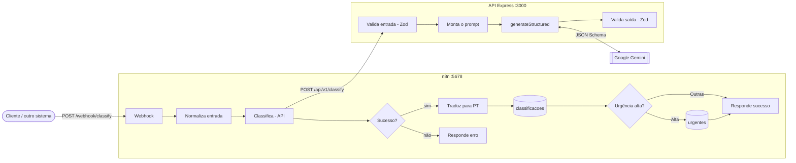

Cada parte tem uma responsabilidade:

- **n8n:** porta de entrada e orquestração. Normaliza os dados, chama a API, traduz para português, grava no Sheets e responde a quem chamou.
- **API Express:** recebe e valida, monta o prompt, chama o Gemini e **garante** o formato da resposta. Não conhece o Google Sheets.
- **Gemini:** interpreta o texto e devolve JSON no schema pedido.

### Como a API recebe os dados

`POST /api/v1/classify` aceita:

```json
{ "message": "texto do cliente", "customer": "nome (opcional)", "channel": "whatsapp" }
```

- `message`: obrigatório, 5 a 5000 caracteres, com espaços das pontas removidos.
- `customer`: opcional, até 120 caracteres.
- `channel`: `email`, `whatsapp`, `website`, `phone` ou `other` (padrão `other`).

A entrada é validada com Zod antes de qualquer chamada à IA. Entrada inválida volta como **400** com o campo e o motivo, sem gastar cota do Gemini. O corpo é limitado a 32 kb (**413** acima disso).

### Como a IA processa

O prompt fica em [`classify.prompt.ts`](api/src/modules/classify/classify.prompt.ts), separado da rota:

- **Papel e critérios explícitos:** definição de cada categoria, qual setor cuida de quê (pagamento → Financeiro; entrega, troca e devolução → Logística; site e login → Suporte técnico; orçamento e revenda → Comercial) e o que torna uma mensagem urgente (prejuízo financeiro, reincidência, ameaça de Procon ou de cancelar, linguagem agressiva).
- **Uma fonte de verdade:** categorias, setores e limites ficam em [`classify.constants.ts`](api/src/modules/classify/classify.constants.ts) e são usados **ao mesmo tempo** pelo schema e pelo prompt. Mudar uma categoria muda os dois; eles nunca divergem.
- **3 exemplos (few-shot)** tipados com o mesmo tipo da resposta: um exemplo fora do contrato nem compila.
- **Regra de desempate:** se a mensagem cabe em duas categorias, vale a que exige ação da loja (reclamação ou solicitação antes de dúvida).
- **Proteção contra prompt injection:** a mensagem do cliente vai entre tags `<customer_message>`, o prompt manda tratá-la só como dado, e tags iguais dentro do texto do cliente são removidas antes do envio.
- **Privacidade no resumo:** o resumo chama a pessoa de "Cliente", nunca pelo nome (o nome já está em outra coluna).
- `temperature` 0,2: classificação pede consistência, não criatividade.

### Como garantir que a resposta da IA está no formato certo

São três camadas, em [`lib/gemini.ts`](api/src/lib/gemini.ts):

1. **Saída estruturada do Gemini:** a chamada envia `responseMimeType: application/json` e um **JSON Schema gerado do mesmo schema Zod** da resposta. O modelo é restringido a esse formato.
2. **Validação Zod na volta:** mesmo assim, a resposta passa por `JSON.parse` e pelo schema Zod (enums, tamanhos, faixa de 0 a 1 da confiança) **antes** de sair da API. Nada que não passou pela validação chega ao n8n.
3. **Retry e erros claros:**
   - resposta vazia, JSON inválido ou fora do schema → **1 nova tentativa**; falhou de novo → **502** `AI_INVALID_RESPONSE`;
   - Gemini sobrecarregado, cota (429), erro 5xx ou de rede → **1 nova tentativa após 1 s**; falhou de novo → **503** `AI_UNAVAILABLE`;
   - tudo dentro de um prazo único de 20 s (`GEMINI_TIMEOUT_MS`), retries incluídos, para quem chama ter um limite previsível.

A resposta de sucesso sempre tem o mesmo envelope:

```json
{
  "id": "uuid",
  "processed_at": "2026-11-25T20:28:35.254Z",
  "input": { "...": "a entrada validada" },
  "result": { "...": "a classificação validada" },
  "meta": { "model": "gemini-3.5-flash-lite", "latency_ms": 1681 }
}
```

### Por que spam e mensagens ambíguas têm confiança baixa

Spam ("Você ganhou um iPhone!") e mensagens vagas ("Oi, sobre aquilo que eu falei...") recebem **categoria Outro, urgência Baixa e confiança de no máximo 0,5**, por regra do prompt, mesmo quando o modelo tem certeza de que é spam.

É proposital: aqui a confiança responde à pergunta **"dá para encaminhar automaticamente?"**, e não "quão certa a IA está". Confiança baixa sinaliza que a mensagem não tem um setor de destino claro e que, se alguém quiser, pode revisá-la. Assim, um filtro simples na planilha (`confianca <= 0,5`) separa tudo o que não deve seguir sozinho.

### Como a automação executa

O workflow [`n8n/workflows/4.1-classify.json`](n8n/workflows/4.1-classify.json):

| Node | O que faz |
|---|---|
| **Webhook** | Recebe `POST /webhook/classify` e espera o node de resposta para responder. |
| **Normaliza entrada** | Garante `message`, `customer` e `channel` (padrão `other`) e registra `received_at` no fuso de São Paulo. |
| **Classifica (API)** | `POST http://api:3000/api/v1/classify`, com timeout de 30 s. Configurado para devolver status e corpo completos sem falhar em erro HTTP. |
| **Sucesso?** | IF `statusCode == 200`. É o ramo de erro do fluxo. |
| **Traduz para PT** | Converte os valores da API em rótulos da planilha (`complaint` → Reclamação, `logistics` → Logística...) e gera exatamente as colunas da planilha. |
| **Registra na planilha** | Append Row na aba `classificacoes`. |
| **Urgência alta?** | Switch pelo valor da API (`urgency == high`), e não pelo rótulo traduzido. |
| **Registra urgente** | Append Row na aba `urgentes` (só urgência alta). |
| **Responde sucesso** | Devolve a quem chamou o JSON completo da API. |
| **Responde erro** | Devolve **o mesmo status e corpo de erro** da API (400, 502, 503...). Se a API estiver fora do ar, responde 502 `API_UNREACHABLE`. |

Planilha **"Loja Aurora — Atendimento"**, abas `classificacoes` e `urgentes`, com as colunas:

`recebido_em | cliente | canal | mensagem | categoria | setor | urgencia | sentimento | resumo | confianca`

## 6. Como executar

### Pré-requisitos

- Docker e Docker Compose.
- Uma chave da API do Gemini ([Google AI Studio](https://aistudio.google.com/apikey); o plano gratuito basta).
- Uma conta Google para a planilha.
- Sem Docker: Node.js 24 (com [fnm](https://github.com/Schniz/fnm), `fnm use` lê o `.nvmrc`).

### 1. Variáveis de ambiente

```bash
cp .env.example .env
```

Preencha no `.env`:

| Variável | Valor |
|---|---|
| `GEMINI_API_KEY` | Sua chave do Google AI Studio |
| `GEMINI_MODEL` | `gemini-3.5-flash-lite` |
| `N8N_ENCRYPTION_KEY` | Uma string aleatória longa, por exemplo `openssl rand -hex 32`. Ela criptografa as credenciais salvas no n8n: **não troque depois** |

As demais têm valores padrão adequados.

### 2. Subir com Docker (recomendado)

```bash
docker compose up --build
```

| Serviço | URL |
|---|---|
| API | http://localhost:3000/health |
| Swagger | http://localhost:3000/docs |
| n8n | http://localhost:5678 |

> **Na primeira execução** o Docker baixa a imagem do n8n (cerca de 2,2 GB), o que pode levar alguns minutos.
>
> **Porta 3000:** o Docker e o `npm run dev` usam a mesma porta. Rode um ou outro; se a API local estiver de pé, o `docker compose up` falha com "port is already allocated".

O n8n só sobe depois que a API passa no healthcheck.

### 3. Configurar o n8n e a planilha

1. Abra http://localhost:5678 e crie a conta de administrador local (pedida só no primeiro acesso).
2. Crie a planilha e a credencial do Google seguindo o guia [`docs/guias/google-sheets-n8n.md`](docs/guias/google-sheets-n8n.md) (cerca de 15 minutos). A planilha precisa das abas `classificacoes` e `urgentes`, com os cabeçalhos acima.
3. Em **Workflows → Import from File**, importe [`n8n/workflows/4.1-classify.json`](n8n/workflows/4.1-classify.json).
4. Nos nodes **Registra na planilha** e **Registra urgente**, selecione a sua credencial e a **sua** planilha. O JSON exportado aponta para a planilha do autor, à qual você não tem acesso.
5. **Ative** o workflow (o botão no topo). A URL de produção `/webhook/classify` só responde com o workflow ativo; a de teste `/webhook-test/classify` só responde com o editor escutando.

### 4. Testar

Uma mensagem:

```bash
curl -s -X POST http://localhost:5678/webhook/classify \
  -H 'Content-Type: application/json' \
  -d '{"message":"Fui cobrada duas vezes no cartão pelo pedido #5530. Preciso do estorno!","customer":"Juliana","channel":"email"}'
```

As 14 mensagens de exemplo de [`api/samples/messages.json`](api/samples/messages.json), cobrindo todas as categorias, setores e urgências, mais spam e uma mensagem ambígua:

```bash
node scripts/send-samples.ts
```

O script roda com o Node 24 puro, sem instalar nada, e espera 4 s entre as mensagens por causa do limite do plano gratuito do Gemini. `WEBHOOK_URL` e `DELAY_MS` podem ser trocados por variável de ambiente.

> Se uma mensagem voltar **503 `AI_UNAVAILABLE`**, foi o Gemini sobrecarregado ("high demand") mesmo depois da nova tentativa. A API e o fluxo continuam de pé; é só reenviar aquela mensagem.

### Sem Docker (só a API)

```bash
fnm use                # Node 24 a partir do .nvmrc
cd api
npm ci
npm run dev            # http://localhost:3000, lê o ../.env
```

Build de produção: `npm run build && npm start`.

Para usar o n8n fora do Docker, troque a URL do node **Classifica (API)** de `http://api:3000` para `http://localhost:3000`: o nome `api` só existe dentro da rede do Compose.

### Testes e qualidade

```bash
cd api
npm test               # Vitest + Supertest, Gemini sempre mockado (não gasta cota)
npm run lint           # ESLint: typescript-eslint strict + regras SonarJS
npm run typecheck      # tsc --noEmit
```

Os testes cobrem a validação da entrada, o envelope de sucesso e de erro, retry e timeout do Gemini, o mapeamento de erros (400/413/500/502/503), a geração do Swagger e a remoção das tags de delimitação no prompt.

## 7. Documentação do fluxo n8n

### Fluxo completo

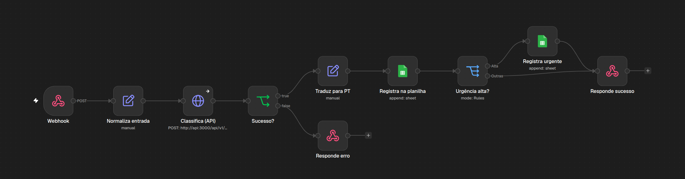

Do webhook à resposta: o ramo de cima é o caminho de sucesso (traduz, grava e copia as urgentes); o de baixo, o de erro.

### Configuração de cada node

**Webhook:** recebe `POST /webhook/classify` e responde pelo node "Responde", depois que o fluxo termina.

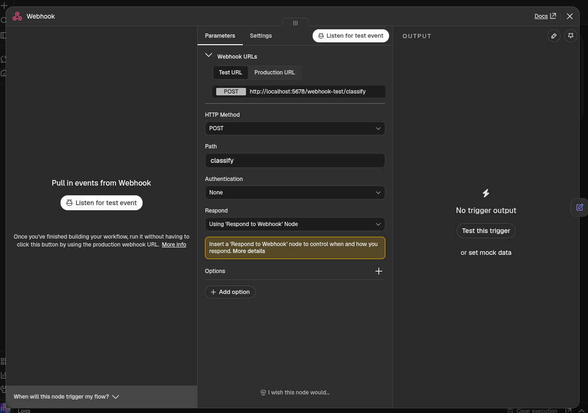

**Normaliza entrada (Edit Fields):** padroniza os campos e registra a data e hora de recebimento.

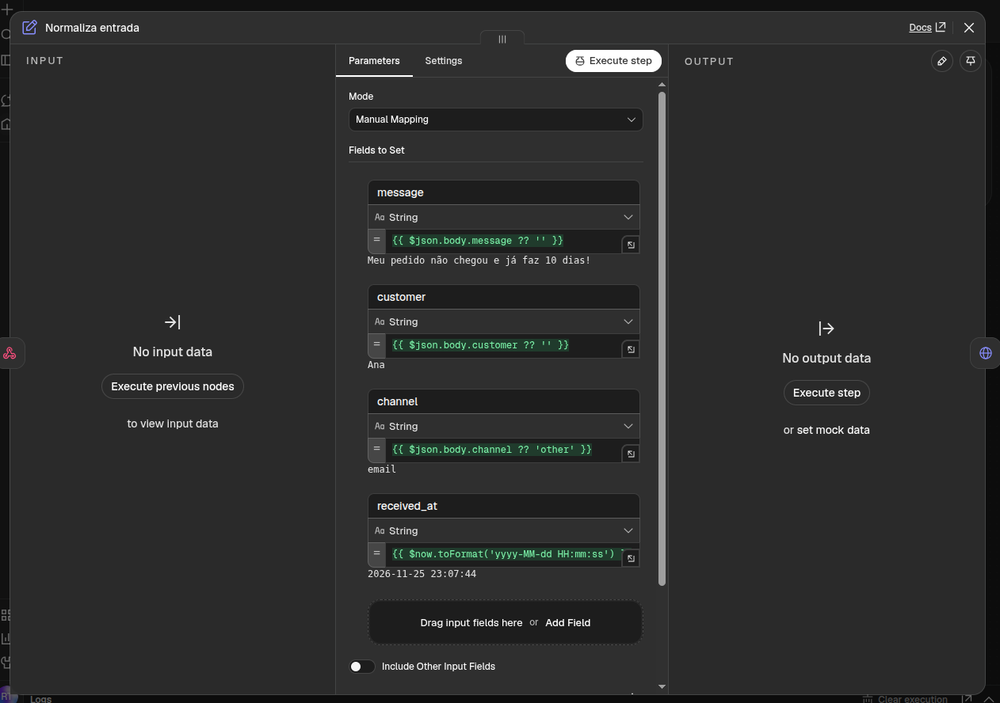

**Classifica (API) (HTTP Request):** envia a mensagem para a API Express, que chama o Gemini.

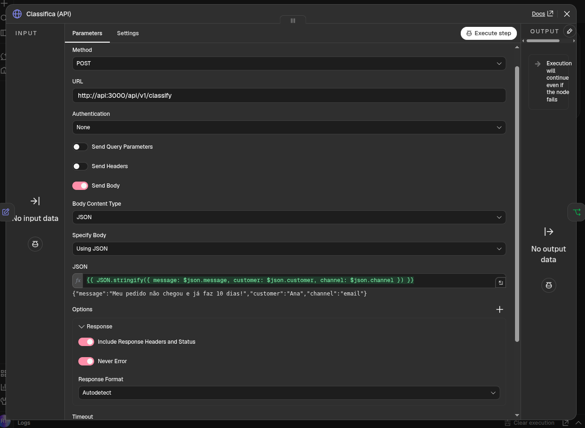

**Sucesso? (IF):** separa a resposta 200 dos erros da API.

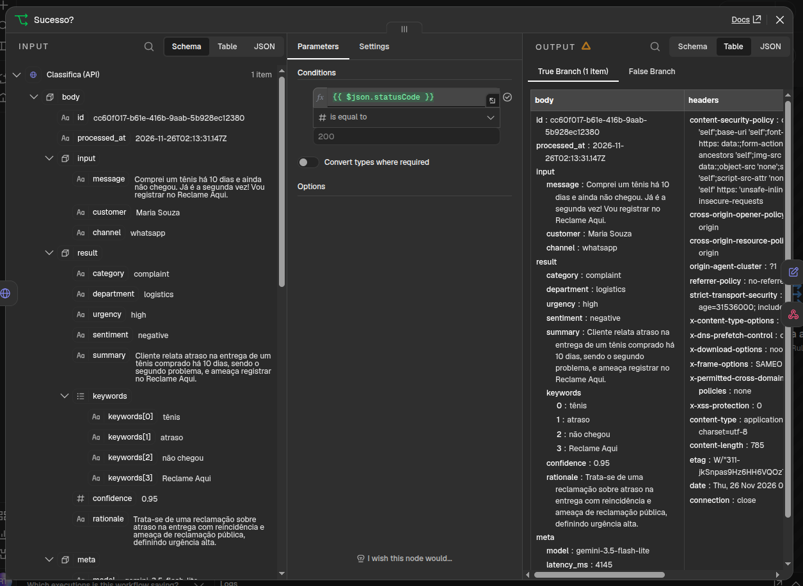

**Traduz para PT (Edit Fields):** transforma os valores do contrato (em inglês) nos rótulos da planilha (em português).


**Registra na planilha (Google Sheets):** acrescenta a linha na aba `classificacoes`, mapeando as colunas pelo nome.

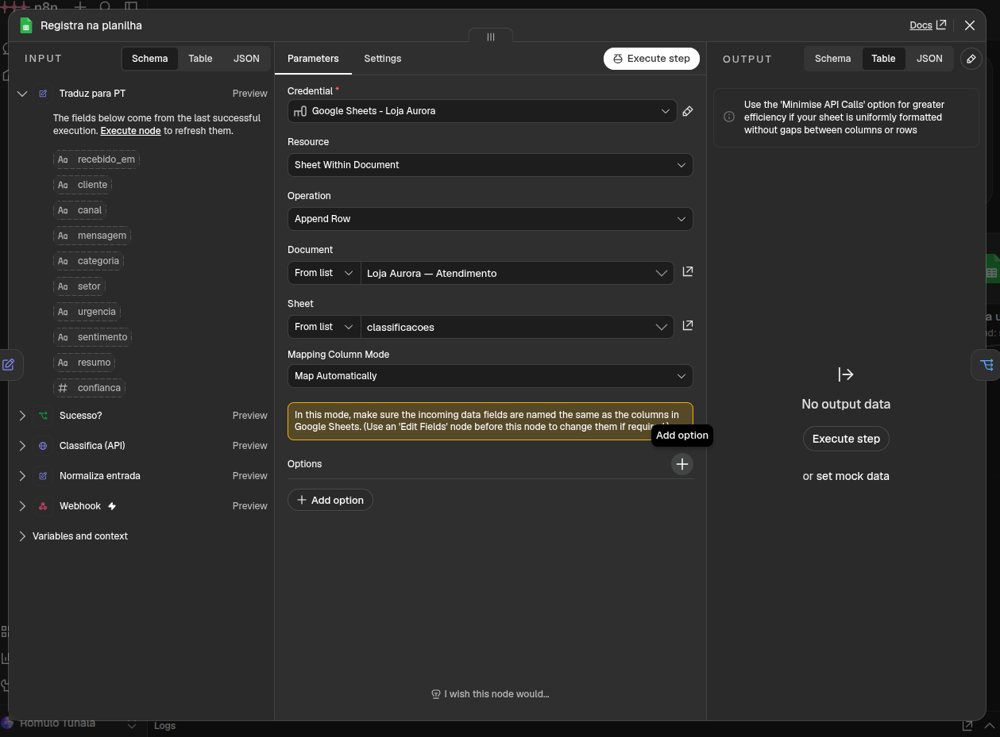

**Urgência alta? (Switch):** envia as mensagens de urgência alta também para a aba `urgentes`.

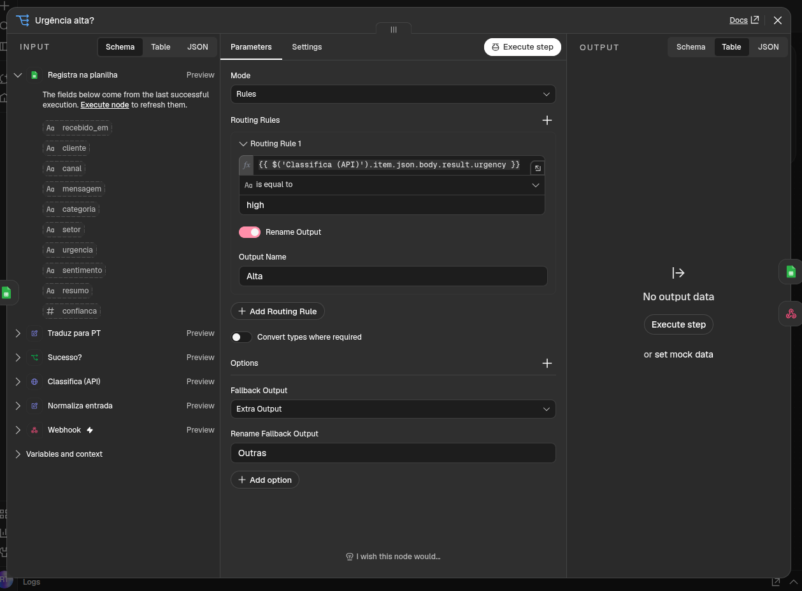

**Responde sucesso / Responde erro (Respond to Webhook):** devolvem a quem chamou o JSON da API, ou o erro com o mesmo status.

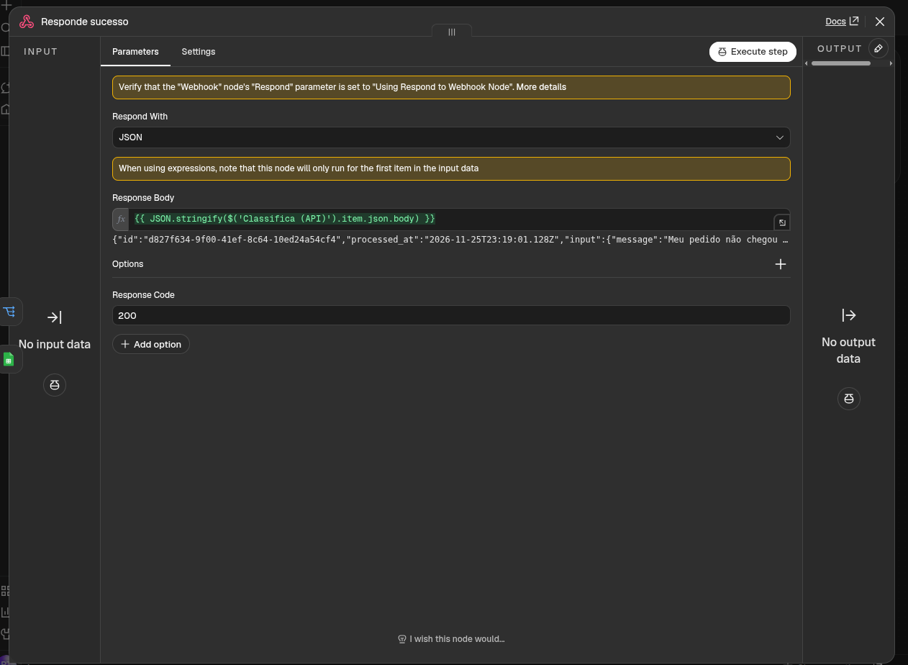

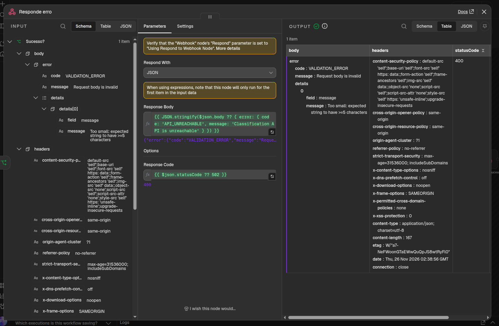

### Execução e resultados

**Execução bem-sucedida:** todos os nodes do caminho de sucesso concluídos.

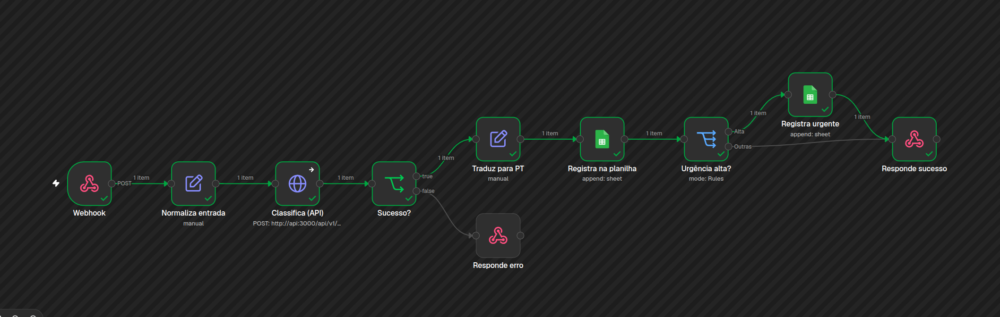

**Dados no HTTP Request:** a mensagem enviada e o JSON classificado que voltou da API.

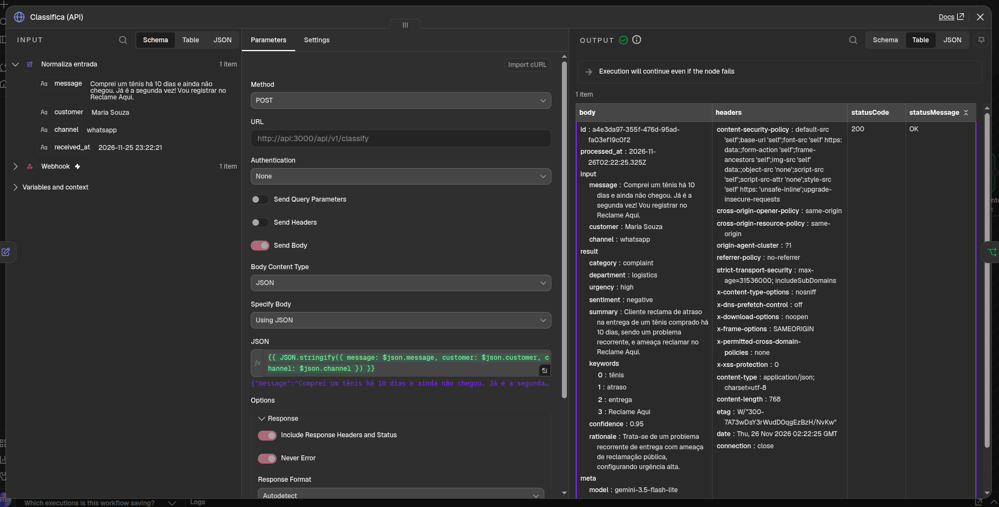

**Dados no Google Sheets:** a linha já traduzida que chega ao node da planilha.

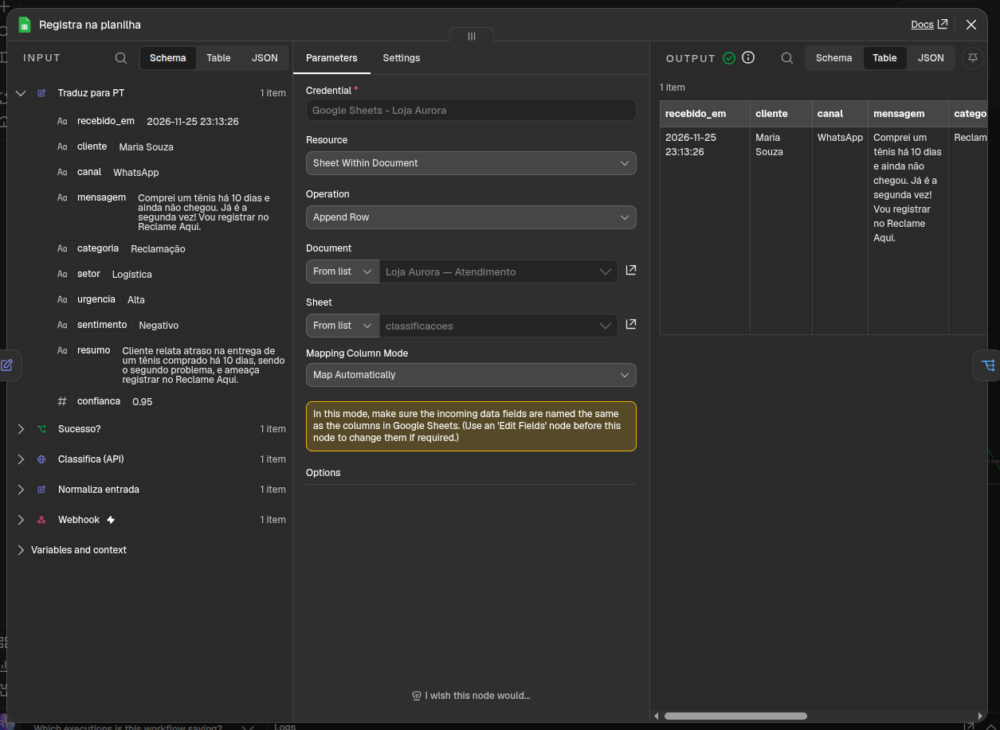

**Planilha preenchida:** as 14 mensagens de exemplo classificadas, e as de urgência alta na aba `urgentes`.

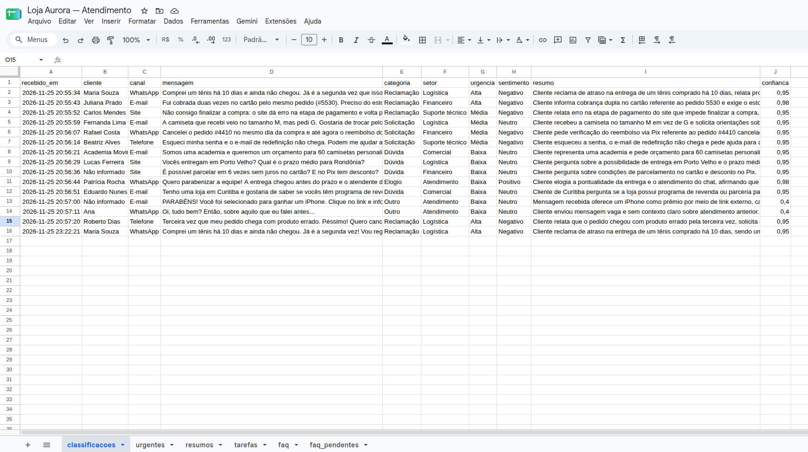

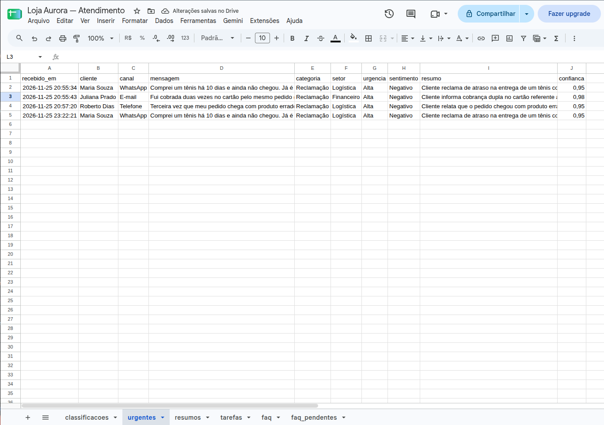

## 8. Endpoints e Swagger

| Método | Rota | Descrição |
|---|---|---|
| `GET` | `/health` | Status da API: `{ "status": "ok", "uptime_s": 12 }` |
| `POST` | `/api/v1/classify` | Classifica uma mensagem (caso 4.1) |
| `GET` | `/docs` | Swagger UI |
| `GET` | `/docs.json` | Documento OpenAPI 3.1 |

O Swagger é gerado dos mesmos schemas Zod que validam as requisições, então a documentação não fica desatualizada em relação ao código.

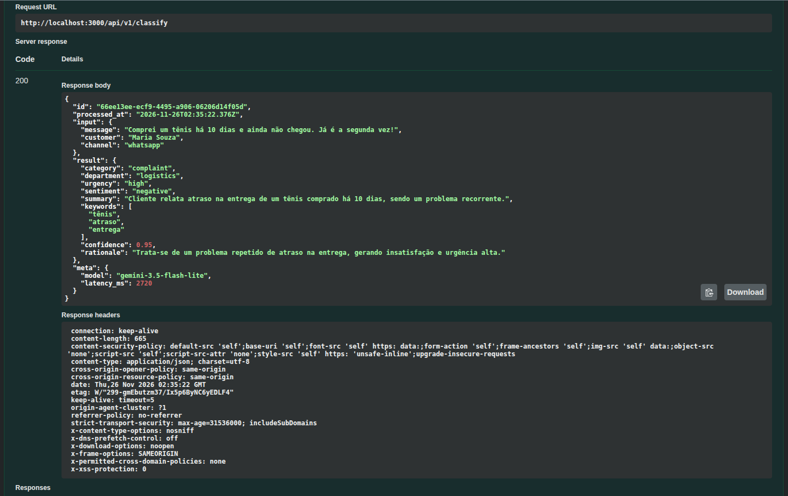

### Exemplo real

Requisição feita pelo Swagger, com a chave real do Gemini:

```json
{
  "message": "Comprei um tênis há 10 dias e ainda não chegou. Já é a segunda vez!",
  "customer": "Maria Souza",
  "channel": "whatsapp"
}
```

Resposta (200):

```json
{
  "id": "648a7076-6605-4072-9318-ac07ff26f31b",
  "processed_at": "2026-11-25T20:28:35.254Z",
  "input": {
    "message": "Comprei um tênis há 10 dias e ainda não chegou. Já é a segunda vez!",
    "customer": "Maria Souza",
    "channel": "whatsapp"
  },
  "result": {
    "category": "complaint",
    "department": "logistics",
    "urgency": "high",
    "sentiment": "negative",
    "summary": "Cliente reclama que o tênis comprado há 10 dias ainda não chegou, sendo a segunda ocorrência do problema.",
    "keywords": ["tênis", "atraso", "entrega"],
    "confidence": 0.95,
    "rationale": "Trata-se de uma reclamação sobre atraso na entrega com reincidência, gerando insatisfação e urgência alta."
  },
  "meta": {
    "model": "gemini-3.5-flash-lite",
    "latency_ms": 6214
  }
}
```

A reincidência ("já é a segunda vez") é o que eleva a urgência para alta, conforme o critério do prompt.

### Erros

Todos os erros usam o mesmo envelope:

```json
{ "error": { "code": "VALIDATION_ERROR", "message": "Request body is invalid", "details": [{ "field": "message", "message": "..." }] } }
```

| HTTP | `code` | Quando |
|---|---|---|
| 400 | `VALIDATION_ERROR` | Entrada inválida ou JSON malformado |
| 404 | `NOT_FOUND` | Rota inexistente |
| 413 | `PAYLOAD_TOO_LARGE` | Corpo acima de 32 kb |
| 500 | `INTERNAL_ERROR` | Erro inesperado ou configuração errada (ex.: chave do Gemini inválida) |
| 502 | `AI_INVALID_RESPONSE` | O Gemini devolveu JSON fora do schema duas vezes |
| 503 | `AI_UNAVAILABLE` | Timeout, rede, cota ou Gemini indisponível, após a nova tentativa |

## 9. Decisões técnicas

- **Contrato em inglês, planilha em português.** Campos e valores da API (`category: "complaint"`) são em inglês e `snake_case`: estáveis, sem acentos e fáceis de consumir por qualquer sistema. Quem lê a planilha é a equipe de atendimento, então a tradução para "Reclamação" acontece no n8n, na apresentação. Trocar um rótulo não exige mexer na API. Os textos livres gerados pela IA (resumo e justificativa) já saem em português.
- **A API não conhece o Google Sheets.** Ela só classifica; o destino é decisão da automação. A mesma API serve ao n8n, ao Swagger e a um front futuro sem mudança.
- **Uma chamada ao Gemini por mensagem, com schema.** Mais simples e barato do que encadear chamadas, e a saída estruturada elimina o parsing de texto livre.
- **Um módulo por caso.** Cada caso (`classify`, e no futuro `summarize`, `tasks`, `faq`) é uma pasta independente que reaproveita a infraestrutura comum (`lib/gemini.ts`, envelope, erros, Swagger). Passo a passo em [`docs/adicionar-novo-caso.md`](docs/adicionar-novo-caso.md).
- **Ramo de erro por status, não por exceção.** O HTTP Request do n8n devolve a resposta completa mesmo em erro, e um IF decide o caminho. Assim o erro original da API (código e mensagem) chega intacto a quem chamou o webhook.

## 10. Estrutura de pastas

```
.
├── api/                          # API Express (TypeScript)
│   ├── Dockerfile                # multi-stage, node:24-alpine, usuário não-root
│   ├── samples/messages.json     # 14 mensagens de exemplo
│   └── src/
│       ├── app.ts                # monta o Express (exportado para os testes)
│       ├── server.ts             # sobe o servidor, encerramento gracioso
│       ├── config/env.ts         # variáveis de ambiente validadas com Zod
│       ├── lib/
│       │   ├── gemini.ts         # generateStructured(): saída JSON + Zod + retry + timeout
│       │   ├── envelope.ts       # envelope de sucesso
│       │   ├── errors.ts         # AppError, códigos e middleware de erro
│       │   ├── openapi.ts        # registro e geração do Swagger
│       │   └── logger.ts
│       ├── middlewares/validate.ts
│       ├── routes/               # health, docs e registro dos módulos
│       └── modules/classify/     # caso 4.1
│           ├── classify.constants.ts   # enums, limites e critérios (schema e prompt)
│           ├── classify.schema.ts      # entrada e saída (Zod)
│           ├── classify.prompt.ts      # system prompt e montagem do prompt
│           ├── classify.service.ts
│           ├── classify.route.ts
│           └── classify.test.ts
├── n8n/workflows/4.1-classify.json   # workflow exportado
├── scripts/send-samples.ts           # envia os exemplos ao webhook
├── docs/
│   ├── adicionar-novo-caso.md
│   ├── guias/google-sheets-n8n.md
│   ├── planejamento/                 # requisitos, arquitetura e fases
│   └── prints/fase-1/
├── docker-compose.yml                # api + n8n
├── .env.example
└── .nvmrc                            # 24
```

## 11. Segurança

- **Nenhuma credencial no repositório:** só o `.env.example`, com valores fictícios. O `.env` está no `.gitignore` e no `.dockerignore`, então também não entra na imagem.
- As credenciais do Google ficam no volume do n8n (`n8n_data`), criptografadas com `N8N_ENCRYPTION_KEY`. O JSON do workflow só referencia a credencial pelo nome.
- Os logs não registram a chave do Gemini nem o conteúdo das mensagens: em caso de resposta inválida da IA, só o motivo é registrado.
- A API roda como usuário não-root no container, com `helmet` e limite de tamanho do corpo.

## 12. Próximos passos

- **Interface web (Next.js)** para enviar mensagens e ver o resultado, chamando o webhook pelo servidor.
- **Casos opcionais** com a mesma estrutura de módulo: 4.2 Resumo, 4.3 Organização de tarefas e 4.4 Assistente de FAQ.
- **Avisos ativos** para urgência alta (e-mail ou Slack) além da aba `urgentes`.
- **Fila para envios em lote**, para respeitar o limite de requisições do Gemini sem depender de pausas no cliente.
- **Autenticação do webhook** (token no header) antes de expor o n8n fora da rede local.
